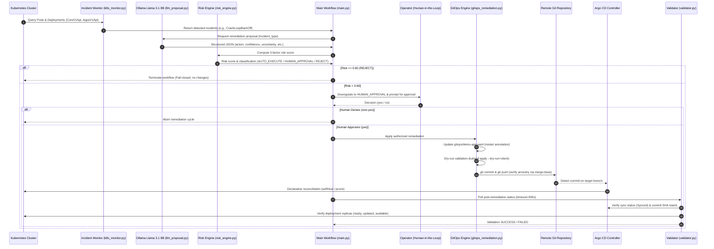

# KubeGuard AI — AI-Driven Kubernetes Remediation with Risk-Adaptive GitOps Authorization

[](https://www.python.org/)
[-326CE5.svg)](https://kubernetes.io/)
[](https://argo-cd.readthedocs.io/)
[](https://ollama.com/)
[]()
[]()

> [!IMPORTANT]
> **Operational Status & Verification Scope Disclosure:**
> - **Mocked Workflow Verification:** All 74 automated unit and integration tests execute against controlled mock harnesses (`unittest.mock`), simulating Kubernetes API calls, Git push operations, and Argo CD responses.
> - **No Unsupervised Live Mutations:** Live end-to-end remediation has **not** been executed against the active cluster to preserve baseline stability and avoid unintended Git drift.
> - **Self-Reported Risk Guardrail:** Large Language Model (LLM) risk scores are **self-reported token probabilities**, not calibrated empirical certainties. In accordance with KubeGuard AI's **Zero-Unsupervised-Mutation Safeguard**, all `AUTO_EXECUTE` recommendations are systematically downgraded to **mandatory human approval**.

---

## Table of Contents

1. [Project Overview](#1-project-overview)
2. [Problem Statement and Objectives](#2-problem-statement-and-objectives)
3. [Research Gap and Proposed Approach](#3-research-gap-and-proposed-approach)
4. [System Architecture and Component Descriptions](#4-system-architecture-and-component-descriptions)
5. [Technology Stack](#5-technology-stack)
6. [Five-Factor Risk Assessment Formula and Thresholds](#6-five-factor-risk-assessment-formula-and-thresholds)
7. [Ollama Llama 3.1 8B Integration](#7-ollama-llama-31-8b-integration)
8. [Human Approval and Rejection Workflow](#8-human-approval-and-rejection-workflow)
9. [Kubernetes, Prometheus, Grafana, and Argo CD Roles](#9-kubernetes-prometheus-grafana-and-argo-cd-roles)
10. [Project Directory Structure](#10-project-directory-structure)
11. [Prerequisites and Installation Instructions](#11-prerequisites-and-installation-instructions)
12. [Configuration and Execution Instructions](#12-configuration-and-execution-instructions)
13. [How to Run Automated Tests](#13-how-to-run-automated-tests)
14. [Evidence Collected and Actual Verification Results](#14-evidence-collected-and-actual-verification-results)
15. [Limitations and Future Improvements](#15-limitations-and-future-improvements)

---

## 1. Project Overview

**KubeGuard AI** is an intelligent, self-healing framework for Kubernetes clusters that unifies **local generative AI reasoning**, a **mathematical five-factor risk engine**, a **mandatory human-in-the-loop authorization safeguard**, and **declarative GitOps reconciliation**.

Rather than permitting autonomous agents to run arbitrary imperative commands directly on production clusters, KubeGuard AI enforces strict architectural boundaries:
- **Local LLM Reasoning:** Uses a locally hosted `llama3.1:8b` via Ollama to diagnose Kubernetes incidents and generate structured remediation proposals without data egress.
- **Deterministic Risk Engine:** Scores remediation safety across five orthogonal dimensions: confidence, uncertainty, policy compliance, reversibility, and blast radius.
- **Fail-Closed Authorization Safeguard:** Programmatically downgrades any `AUTO_EXECUTE` output to `HUMAN_APPROVAL`, ensuring human engineers maintain ultimate accountability.
- **GitOps-Native Remediation:** Executes approved actions solely by committing versioned manifest updates to a Git repository, allowing Argo CD to declaratively synchronize state and prevent configuration drift.
- **Closed-Loop Post-Remediation Validation:** Polling verification ensures the target commit SHA is synchronized by Argo CD and deployment replicas are fully available and healthy.

---

## 2. Problem Statement and Objectives

### Problem Statement
Modern microservice architectures deployed on Kubernetes experience frequent runtime disruptions, ranging from transient container crashes (`CrashLoopBackOff`) to image pull failures (`ImagePullBackOff`, `ErrImagePull`) and replica degradation. Traditional responses suffer from critical flaws:
1. **Manual Remediation Latency:** On-call engineers experience alert fatigue and delays diagnosing root causes from container logs and status objects.
2. **GitOps Drift & Flawed Imperative Self-Healing:** Autonomous self-healing scripts that apply direct imperative patches (`kubectl patch`, `kubectl delete pod`) bypass GitOps workflows. In clusters governed by controllers like Argo CD with `selfHeal: true`, imperative mutations are immediately overwritten by the desired state in Git, inducing reconciliation thrashing.
3. **Ungoverned AI Agents & Hallucinations:** Generative AI models are prone to hallucinating dangerous, non-existent, or destructive commands (e.g., namespace deletions or unauthenticated role modifications). Unchecked execution of raw LLM output on infrastructure introduces severe operational risk.

### Objectives
- **Declarative Self-Healing:** Channel all remediation actions through version-controlled GitOps manifests (`gitops/demo-app.yaml`), eliminating cluster drift.
- **Bounded Diagnostic Proposal:** Restrict local LLM output to an allowlisted action catalog and a strict JSON schema with zero shell execution privileges.
- **Mathematical Risk Quantization:** Replace arbitrary thresholds with an explicit five-factor linear risk model evaluating operational impact.
- **Fail-Closed Human Governance:** Guarantee that no remediation is applied without explicit human authorization, treating LLM risk scores as uncalibrated heuristics.
- **Dual-Plane Validation:** Confirm both GitOps continuous delivery synchronization (exact commit SHA matching) and Kubernetes runtime pod health before declaring success.

---

## 3. Research Gap and Proposed Approach

### Research Gap Matrix

| Remediation Paradigm | Semantic Incident Awareness | GitOps Drift Prevention | Risk-Bounded Execution | Hallucination Containment | Human Accountability |
|---|---|---|---|---|---|
| **Native K8s (RestartPolicy / HPA)** | ❌ None (Purely reactive) | ⚠️ Cluster-local only | ❌ Blind restarts | N/A | ❌ None |
| **Traditional AIOps / Imperative Bots** | ⚠️ Rule-based / static | ❌ Direct mutation causes drift | ⚠️ Static severity tables | N/A | ⚠️ Coarse approval |
| **Unconstrained LLM Autonomous Agents** | ✅ High (Semantic context) | ❌ Imperative shell scripts | ❌ Relies on raw prompt text | ❌ High risk of hallucination | ❌ Autonomous execution |
| **KubeGuard AI (This Work)** | **✅ High (`llama3.1:8b`)** | **✅ Strict GitOps via Argo CD** | **✅ 5-Factor Linear Formula** | **✅ Strict JSON Schema & Allowlist** | **✅ Mandatory Operator Verification** |

### Proposed Approach
KubeGuard AI combines generative AI with deterministic control theory:
1. **Detection:** Direct API monitoring of Kubernetes Pod and Deployment status objects.
2. **Proposal:** Prompting a local Ollama `llama3.1:8b` model under low temperature ($0.1$) with a strict JSON format contract.
3. **Validation & Risk Calculation:** Rejecting invalid schemas or out-of-bounds metrics, then computing scalar risk via the five-factor formula.
4. **Human Verification:** Enforcing human sign-off for any low- or moderate-risk action; immediately rejecting high-risk actions ($\ge 0.60$).
5. **Declarative Mutation & Push:** Updating pod-template restart annotations, validating via client dry-run, committing, and verifying remote push ancestry.
6. **Closed-Loop Verification:** Polling Argo CD Application CRD and Deployment replicas until convergence.

---

## 4. System Architecture and Component Descriptions

### Architectural Workflow



### Component Descriptions

#### 1. Incident Monitor (`k8s_monitor.py`)
- Loads Kubernetes configuration via `config.load_kube_config()`.
- Inspects pods in namespace `ai-remediation` using `CoreV1Api.list_namespaced_pod`.
- Scans container statuses for restart counts and waiting reasons (`CrashLoopBackOff`, `ImagePullBackOff`, `ErrImagePull`).
- Inspects deployments using `AppsV1Api.list_namespaced_deployment` for available vs desired replica mismatches.
- Implements `select_primary_incident()` prioritizing `pod_failure` over other incidents.

#### 2. LLM Proposal Generator (`llm_proposal.py`)
- Connects to local Ollama API (`http://localhost:11434/api/chat`) using standard library `urllib.request`.
- Targets `llama3.1:8b` with system instructions enforcing JSON-only output and temperature $0.1$.
- Enforces an allowlist of supported incident types (`pod_failure`, `pod_crash`, `pod_restart`) and actions (`ALLOWED_ACTIONS = {"restart_pod"}`).
- Performs rigorous schema validation in `_validate_proposal()`: checks for exactly 8 keys, non-empty description, valid numerical ranges $[0.0, 1.0]$, and rejects booleans, NaNs, or infinite values. Raises `ProposalError` upon failure.

#### 3. Risk Engine (`risk_engine.py`)
- Evaluates the five orthogonal risk parameters using a weighted linear model.
- Classifies risk into `AUTO_EXECUTE` ($< 0.30$), `HUMAN_APPROVAL` ($[0.30, 0.60)$), or `REJECT` ($\ge 0.60$).
- Provides standalone CLI capability to assess live detected incidents.

#### 4. Workflow Coordinator & Authorization Safeguard (`main.py`)
- Orchestrates the full lifecycle: detection $\rightarrow$ proposal $\rightarrow$ risk calculation $\rightarrow$ authorization $\rightarrow$ GitOps execution $\rightarrow$ validation.
- Implements the **Zero-Unsupervised-Mutation Safeguard**: overrides `AUTO_EXECUTE` to `HUMAN_APPROVAL`.
- Implements strict operator input parsing: only case-insensitive `"yes"` authorizes execution; all other inputs immediately abort the workflow.

#### 5. GitOps Remediation Engine (`gitops_remediation.py`)
- Enforces branch protection: refuses execution on `main` or detached `HEAD` states.
- Checks for unrelated staged changes before modifying manifests (`git diff --cached --quiet`).
- Updates `gitops/demo-app.yaml` by generating collision-free pod-template annotations (`ai-remediation/restarted-at`) combining ISO-8601 UTC timestamps with UUID suffixes (`generate_restart_annotation()`).
- Restores the canonical container command (`["nginx", "-g", "daemon off;"]`).
- Validates manifest syntax via `kubectl apply --dry-run=client -f gitops/demo-app.yaml`.
- Commits changes and verifies remote push ancestry via `git fetch origin +refs/heads/<branch>:refs/remotes/origin/<branch>` and `git merge-base --is-ancestor`. Returns a `RemediationResult` object.

#### 6. Post-Remediation Validator (`validator.py`)
- Monitors both Argo CD and Kubernetes Deployment health in a polling loop (`interval=5s`, default `timeout=120s`, configurable to `300s`).
- Queries Argo CD Application custom resource (`argoproj.io/v1alpha1`) via `CustomObjectsApi`.
- Validates `spec.source.targetRevision` against expected branch.
- Verifies exact full 40-character commit SHA (or short prefix) in `status.sync.revision`.
- Confirms `status.sync.status == "Synced"` and `status.health.status == "Healthy"`.
- Validates Deployment replicas (`ready >= desired`, `updated >= desired`, `available >= desired`).

#### 7. Legacy Direct Executor (`executor.py` - Deprecated)
- Implements direct imperative deployment patching via `AppsV1Api.patch_namespaced_deployment`.
- **Marked DEPRECATED**: Direct mutation causes configuration drift in GitOps clusters. Retained solely for backwards compatibility testing and emergency non-GitOps scenarios.

---

## 5. Technology Stack

| Layer | Technology | Version | Purpose in KubeGuard AI |
|---|---|---|---|
| **Language** | Python | 3.14.3 | Core runtime for monitoring, proposal validation, risk evaluation, and GitOps automation. |
| **Orchestration** | Kubernetes | v1.37.0 (Minikube) | Workload hosting and cluster state management; containerd v2.3.4 runtime. |
| **GitOps CD** | Argo CD | v1alpha1 Application CRD | Continuous reconciliation of desired state from Git to live cluster; self-healing engine. |
| **Local LLM** | Ollama / Llama 3.1 | v0.40.13 / 8B (Q4_0, 4.9 GB) | Local semantic analysis, incident explanation, and structured proposal generation. |
| **Version Control** | Git | 2.x+ | Source of truth for desired cluster manifests and audit history. |
| **K8s Client** | `kubernetes` | 36.0.3 | Official Python client for `CoreV1Api`, `AppsV1Api`, and `CustomObjectsApi`. |
| **Data Serialization** | `PyYAML` | 6.0.3 | Multi-document YAML parsing and serialization for GitOps manifests. |
| **Observability (Arch)** | Prometheus & Grafana | Active (`monitoring` namespace) | Metrics foundation for future dynamic telemetry scraping and dashboarding. |
| **Test Framework** | `unittest` | Python Standard Library | Mocked test suite covering 74 unit and integration scenarios. |

---

## 6. Five-Factor Risk Assessment Formula and Thresholds

### Mathematical Formulation
The risk engine implements a bounded linear weighting model evaluating five independent variables:

$$\text{Risk} = (1 - c) \times 0.25 + u \times 0.20 + (1 - p) \times 0.25 + (1 - r) \times 0.15 + b \times 0.15$$

Where each parameter is bounded in the continuous domain $[0.0, 1.0]$:

| Parameter | Symbol | Weight | Definition & Operational Meaning |
|---|---|---|---|
| **Confidence** | $c$ | $0.25$ | Model certainty regarding the diagnosed root cause and appropriateness of the action. High confidence lowers risk. |
| **Uncertainty** | $u$ | $0.20$ | Ambiguity in the incident context or telemetry data. High uncertainty raises risk. |
| **Policy Compliance** | $p$ | $0.25$ | Alignment with cluster operational guidelines, change-window rules, and allowlists. High compliance lowers risk. |
| **Reversibility** | $r$ | $0.15$ | Feasibility of rolling back or recovering if the remediation fails. High reversibility lowers risk. |
| **Blast Radius** | $b$ | $0.15$ | Relative scope of impact across dependent services, pods, or traffic. High blast radius raises risk. |

**Weight Conservation:**
$$\sum w_i = 0.25 + 0.20 + 0.25 + 0.15 + 0.15 = 1.00$$

### Decision Thresholds

| Computed Risk Range | Classification | Engine Decision | Safeguard Effective Decision |
|---|---|---|---|
| $\text{Risk} < 0.30$ | Low Risk | `AUTO_EXECUTE` | **`HUMAN_APPROVAL`** (Safeguard downgrade) |
| $0.30 \le \text{Risk} < 0.60$ | Moderate Risk | `HUMAN_APPROVAL` | **`HUMAN_APPROVAL`** (Operator confirmation) |
| $\text{Risk} \ge 0.60$ | High Risk | `REJECT` | **`REJECT`** (Immediate hard block) |

### Boundary Proofs (from Synthetic Evaluation)
- **Minimum Risk Bound:** $c=1.0, u=0.0, p=1.0, r=1.0, b=0.0 \implies \text{Risk} = 0.0000 \rightarrow$ `AUTO_EXECUTE`
- **Maximum Risk Bound:** $c=0.0, u=1.0, p=0.0, r=0.0, b=1.0 \implies \text{Risk} = 1.0000 \rightarrow$ `REJECT`
- **Boundary Cutoff 1:** $\text{Risk} = 0.2900 \rightarrow$ `AUTO_EXECUTE`; $\text{Risk} = 0.3000 \rightarrow$ `HUMAN_APPROVAL`
- **Boundary Cutoff 2:** $\text{Risk} = 0.5900 \rightarrow$ `HUMAN_APPROVAL`; $\text{Risk} = 0.6000 \rightarrow$ `REJECT`

---

## 7. Ollama Llama 3.1 8B Integration

### Local LLM Deployment
KubeGuard AI runs Ollama locally (`http://localhost:11434/api/chat`) using the Meta Llama 3.1 8B model (`llama3.1:8b`, 4.9 GB).

**Key Benefits of Local Inference:**
- **Zero Cloud Data Egress:** Cluster logs and resource names never leave the local control plane.
- **Predictable Latency:** Unaffected by external rate limits or Internet outages.
- **Cost Isolation:** Zero API token costs.

### Structured JSON Contract
The prompt strictly forces the model into a constrained schema:
```json
{
  "incident": "pod_failure",
  "action": "restart_pod",
  "description": "Restart the failed pod to recover from the failure.",
  "confidence": 0.8,
  "uncertainty": 0.2,
  "policy_compliance": 0.9,
  "reversibility": 0.7,
  "blast_radius": 0.1
}
```

### Safety Guardrails in `llm_proposal.py`
1. **System Prompt Restriction:** Instructs the model to output valid JSON only and follow the schema without conversational markdown or commentary.
2. **Action Allowlist:** Only `restart_pod` is permitted. Any other proposal (e.g., `delete_namespace`, `scale_to_zero`, arbitrary bash commands) immediately raises `ProposalError`.
3. **Incident Cross-Check:** The returned `incident` field must strictly match the queried incident.
4. **Type and Bound Enforcement:** All 5 risk metrics must be finite numeric values (int/float) in $[0.0, 1.0]$. Booleans (which inherit from int in Python), NaNs, and infinities are rejected.
5. **Fail-Closed Connectivity:** If Ollama is offline or times out (90 seconds), `ProposalError` is raised, terminating the workflow with zero cluster mutation.

---

## 8. Human Approval and Rejection Workflow

### Why LLM Risk Scores are Self-Reported
Generative language models estimate numbers based on token probability distributions. These values represent **subjective model heuristics** rather than calibrated statistical probabilities:
- **Overconfidence Risk:** An LLM may assign $c=0.95$ and $b=0.05$ to an incident whose true cause is shared storage degradation.
- **Prompt Sensitivity:** Minor changes in prompt wording can fluctuate computed risk across threshold boundaries.
- **Lack of Telemetry Grounding:** Without live hardware saturation metrics, the model cannot know if the node is currently experiencing OOM pressure.

### The Mandatory Authorization Safeguard
To guarantee zero accidental or hallucinated infrastructure mutations, `main.py` enforces a strict safeguard:
```python
# LLM self-reported scores are not independently calibrated.
# Therefore, AUTO_EXECUTE is downgraded to HUMAN_APPROVAL.
effective_decision = "HUMAN_APPROVAL"
```

### Review and Authorization Cycle
1. **Incident Presentation:** The operator is presented with the resource type, resource name, severity, and failure reason.
2. **Proposal Review:** The operator inspects the proposed action and natural language description.
3. **Risk Breakdown:** The calculated risk score and engine classification are shown.
4. **Interactive Prompt:**
   ```text
   Approve this GitOps remediation? (yes/no):
   ```
5. **Fail-Closed Enforcement:**
   - Entering `yes` (case-insensitive, whitespace trimmed) triggers GitOps manifest mutation and push.
   - Any other input (`no`, empty return, `abort`, Ctrl+C) halts execution immediately:
     ```text
     Human approval denied. No remediation executed.
     ```
6. **Autonomous Rejection:** If the calculated score $\ge 0.60$, the risk engine issues `REJECT`, and `main.py` aborts immediately without asking the human operator.

---

## 9. Kubernetes, Prometheus, Grafana, and Argo CD Roles

```
+-----------------------------------------------------------------------------------+
|                                 Minikube Cluster                                  |
|                                                                                   |
|  +--------------------+     +---------------------+     +----------------------+  |
|  |   ai-remediation   |     |       argocd        |     |      monitoring      |  |
|  |     namespace      |     |      namespace      |     |      namespace       |  |
|  |                    |     |                     |     |                      |  |
|  |  +--------------+  |     |  +---------------+  |     |  +----------------+  |  |
|  |  |   demo-app   |  |<-------|    Argo CD    |  |     |  |   Prometheus   |  |  |
|  |  | (Deployment) |  |     |  |  Application  |  |     |  | (Metrics Scraper|  |  |
|  |  +--------------+  |     |  |  Controller   |  |     |  |   Foundation)  |  |  |
|  |         |          |     |  +---------------+  |     |  +----------------+  |  |
|  |         |          |     |          ^          |     |          |           |  |
|  |         v          |     |          | sync     |     |          v           |  |
|  |  +--------------+  |     |          |          |     |  +----------------+  |  |
|  |  |   demo-app   |  |     |  +---------------+  |     |  |    Grafana     |  |  |
|  |  |  (Service)   |  |     |  | GitOps Source |  |     |  |  (Dashboard &  |  |  |
|  |  +--------------+  |     |  |  (Git Repo)   |  |     |  | Observability) |  |  |
|  +--------------------+     +---------------------+     +----------------------+  |
+-----------------------------------------------------------------------------------+
```

### Component Roles

- **Kubernetes (Minikube v1.37.0):**
  - Hosts the operational target workload (`demo-app` Deployment and Service) in the `ai-remediation` namespace.
  - Exposes cluster state via `CoreV1Api` (pods, container waiting states, restart counts) and `AppsV1Api` (deployment replicas, ready status).
- **Argo CD (`argocd` namespace):**
  - Manages the `ai-remediation` Application custom resource (`argoproj.io/v1alpha1`).
  - Configured with `repoURL: https://github.com/AIJAY-G/ai-remediation-gitops.git`, `path: gitops`, and `targetRevision: implementation-baseline`.
  - Enforces `automated: {prune: true, selfHeal: true}` to eliminate cluster drift.
  - Serves as the primary synchronization validation target in `validator.py`.
- **Prometheus (`monitoring` namespace):**
  - Cluster telemetry collection backend. While live incident detection in the current phase relies on direct Kubernetes API status checks, Prometheus provides the telemetry foundation for planned dynamic metric scraping (CPU, memory, request error rates).
- **Grafana (`monitoring` namespace):**
  - Observability visualization platform displaying container restart trends, node utilization, and synchronization events for operator situational awareness during manual authorization.

---

## 10. Project Directory Structure

```text
c:\ai-remediation-ai\
├── .gitignore                          # Git ignore rules (.vscode, __pycache__, etc.)
├── README.md                           # Comprehensive project documentation (this file)
├── argocd-application.yaml             # Argo CD Application manifest for ai-remediation
├── argocd-dev-branch-patch.json        # Strategic merge patch for Argo CD targetRevision
├── executor.py                         # DEPRECATED: Legacy direct imperative K8s executor
├── failure-patch.yaml                  # Fault injection patch (CrashLoopBackOff simulation)
├── gitops_remediation.py               # GitOps engine: manifest updating, dry-run, commit & push
├── k8s_monitor.py                      # Incident detector: queries K8s Pods and Deployments
├── llm_proposal.py                     # Ollama Llama 3.1 8B integration & schema validation
├── llm_proposal_phase1_backup.py       # Phase 1 static mock proposal backup
├── main.py                             # Main orchestration workflow with authorization safeguard
├── restore-patch.yaml                  # Fault recovery patch restoring default NGINX command
├── risk_engine.py                      # Five-factor risk calculation engine and CLI
├── validator.py                        # Closed-loop validator: polls Argo CD and Deployment health
│
├── gitops/
│   └── demo-app.yaml                   # GitOps desired-state manifest (Deployment + Service)
│
├── tests/
│   ├── __init__.py                     # Python test package initializer
│   ├── test_executor.py                # Tests for legacy direct executor (5 tests)
│   ├── test_gitops_remediation.py      # Tests for GitOps push, branch checks, manifest update (17 tests)
│   ├── test_incident_selection.py      # Tests for primary incident selection logic (5 tests)
│   ├── test_llm_proposal.py            # Tests for Ollama integration & schema validator (15 tests)
│   ├── test_main_workflow.py           # Tests for end-to-end orchestration & safeguards (15 tests)
│   ├── test_risk_engine.py             # Tests for 5-factor formula and decision thresholds (9 tests)
│   └── test_validator.py               # Tests for Argo CD and Deployment post-remediation checks (8 tests)
│
└── evidence/
    ├── 01_unit_and_integration_tests.txt   # Full test run log (74/74 passed)
    ├── 02_python_compilation_check.txt     # Python bytecode compilation log (clean)
    ├── 03_git_whitespace_check.txt         # Git diff whitespace check log (clean)
    ├── 04_ollama_model_availability.txt    # Ollama version and llama3.1:8b verification log
    ├── 05_real_ollama_proposal.txt         # Real Ollama proposal capture for pod_failure
    ├── 06_kubernetes_cluster_health.txt    # Minikube cluster-info, nodes, namespaces log
    ├── 07_argocd_application_status.txt    # Argo CD application YAML and sync state log
    ├── 08_demo_app_status.txt              # demo-app Deployment & Pod status inspection log
    ├── 09_risk_engine_synthetic_eval.txt   # Multi-scenario synthetic evaluation of risk engine
    └── RESULTS_SUMMARY.md                  # Comprehensive verification summary artifact
```

---

## 11. Prerequisites and Installation Instructions

### Environment Requirements
- **Operating System:** Linux, macOS, or Windows 10/11 (with WSL2)
- **Python:** Python 3.10 to 3.14 (Verified on Python 3.14.3)
- **Kubernetes:** Minikube v1.37.0+ or any standard Kubernetes cluster with `kubectl` configured
- **Argo CD:** Installed in the `argocd` namespace
- **Git:** Git 2.30+ configured with access to the remote repository
- **Ollama:** Ollama v0.40+ installed locally

### Step-by-Step Installation

#### 1. Clone the Repository and Select Branch
```bash
git clone https://github.com/AIJAY-G/ai-remediation-gitops.git c:\ai-remediation-ai
cd c:\ai-remediation-ai
git checkout phase2-ollama-integration
```

#### 2. Configure Python Virtual Environment
```bash
python -m venv venv
# On Windows (PowerShell):
.\venv\Scripts\Activate.ps1
# On Linux/macOS:
source venv/bin/activate

pip install --upgrade pip
pip install kubernetes==36.0.3 PyYAML==6.0.3
```

#### 3. Setup and Verify Ollama
1. Download and install Ollama from [ollama.com](https://ollama.com/).
2. Pull the required Llama 3.1 8B model:
   ```bash
   ollama pull llama3.1:8b
   ```
3. Verify the model is active:
   ```bash
   ollama list
   ```
   *Expected output:* `llama3.1:8b` (Size: approx 4.9 GB).

#### 4. Setup Kubernetes & Argo CD (If running live cluster)
1. Start Minikube:
   ```bash
   minikube start
   ```
2. Verify namespaces:
   ```bash
   kubectl get namespaces
   ```
   *Required namespaces:* `ai-remediation`, `argocd`, `monitoring`.
3. Apply the demo application manifest to the cluster:
   ```bash
   kubectl apply -f gitops/demo-app.yaml
   ```
4. Register the Argo CD Application:
   ```bash
   kubectl apply -f argocd-application.yaml
   ```

---

## 12. Configuration and Execution Instructions

### Code Configuration Parameters
The following key constants are defined across the codebase:

| File | Constant / Parameter | Default Value | Description |
|---|---|---|---|
| `llm_proposal.py` | `OLLAMA_URL` | `http://localhost:11434/api/chat` | Ollama HTTP chat endpoint |
| `llm_proposal.py` | `MODEL` | `llama3.1:8b` | Ollama model identifier |
| `llm_proposal.py` | `TIMEOUT_SECONDS` | `90` | Network timeout for Ollama HTTP requests |
| `k8s_monitor.py` | `NAMESPACE` | `ai-remediation` | Target Kubernetes namespace for monitoring |
| `gitops_remediation.py` | `MANIFEST` | `Path("gitops/demo-app.yaml")` | Path to version-controlled desired state |
| `gitops_remediation.py` | `EXPECTED_DEPLOYMENT` | `demo-app` | Deployment name to patch |
| `validator.py` | `argocd_namespace` | `argocd` | Namespace where Argo CD runs |
| `validator.py` | `application_name` | `ai-remediation` | Argo CD Application custom resource name |
| `main.py` | `timeout` (validation) | `300` | Seconds to wait for Argo CD sync & deployment readiness |

### Running the Complete Orchestration Workflow
To execute the primary remediation loop:
```bash
python main.py
```

**Workflow Execution Path:**
1. Polls Kubernetes for incidents in `ai-remediation`.
2. Selects the primary incident (e.g., `pod_failure`).
3. Calls Ollama `llama3.1:8b` to obtain a remediation proposal.
4. Computes the risk score via `risk_engine.py`.
5. Enforces the authorization safeguard (prompts operator for `yes/no`).
6. If approved, commits annotation updates to `gitops/demo-app.yaml` and pushes to origin.
7. Polls Argo CD and Kubernetes Deployment until synchronization and readiness are confirmed.

### Running Individual Modules for Diagnostic Inspection

- **Inspect Incident Detection:**
  ```bash
  python k8s_monitor.py
  ```
  *Queries live Kubernetes cluster and prints detected incidents and container evidence.*

- **Test Real Ollama Proposal Generation:**
  ```bash
  python llm_proposal.py
  ```
  *Issues a real JSON request to local Ollama for `pod_failure` and prints the validated proposal.*

- **Evaluate Risk Engine Interactively:**
  ```bash
  python risk_engine.py
  ```
  *Detects current incident, requests proposal, and outputs the calculated risk score and decision.*

- **Execute Standalone Post-Remediation Validation:**
  ```bash
  python validator.py
  ```
  *Polls Argo CD application status and Deployment readiness against the current Git HEAD commit.*

- **Simulate Fault Injection (For Controlled Live Testing):**
  ```bash
  # Inject CrashLoopBackOff into demo-app:
  kubectl patch deployment demo-app -n ai-remediation --patch-file failure-patch.yaml

  # Manually restore demo-app to default state if needed:
  kubectl patch deployment demo-app -n ai-remediation --patch-file restore-patch.yaml
  ```

---

## 13. How to Run Automated Tests

### Full Test Suite Execution
The repository contains 74 automated unit and integration tests covering all modules and failure modes.

Run the entire test suite using Python's standard `unittest` runner:
```bash
python -m unittest discover -s tests -v
```

### Test Suite Breakdown

| Test Module | Test Class / Scope | Tests | Coverage Focus |
|---|---|---|---|
| `test_executor.py` | `TestLegacyExecutor` | 5 | Direct K8s API mutation handling, REJECT blocking, approval gates, backwards compatibility alias. |
| `test_gitops_remediation.py` | `TestGitOpsRemediation` | 17 | Branch safety (rejecting `main`/detached HEAD), unpushed commit verification, ancestry checking (`merge-base`), refspec fetching, annotation uniqueness, dry-run schema validation. |
| `test_incident_selection.py` | `TestIncidentSelection` | 5 | Priority logic (prioritizing `pod_failure`), empty lists, defensive non-dict element handling. |
| `test_llm_proposal.py` | `TestOllamaIntegration`<br>`TestProposalValidation` | 15 | Live/mocked Ollama HTTP handling, connection failures, JSON decoding errors, allowlist enforcement, type checks (rejecting booleans, NaNs, negative scores). |
| `test_main_workflow.py` | `TestAutoExecuteDowngrade`<br>`TestHumanApprovalGranted`<br>`TestHumanApprovalDenied`<br>`TestRejectDecision`<br>`TestLLMProposalFailure`<br>`TestGitOpsExecutionFailure` | 15 | End-to-end orchestration in `main.py`, mandatory downgrade of `AUTO_EXECUTE`, strict `"yes"` operator input parsing, git push failure handling. |
| `test_risk_engine.py` | `TestRiskEngine` | 9 | Five-factor linear formula validation, boundary condition checks ($0.0$ and $1.0$), threshold cutoffs ($0.30$ and $0.60$). |
| `test_validator.py` | `TestValidator` | 8 | Argo CD sync polling, exact 40-character SHA matching, branch targetRevision mismatch rejection, unready deployment replicas, missing resources. |
| **Total** | | **74** | **100% Pass Rate** |

### Code Quality and Integrity Checks
Execute compilation and whitespace audits:
```bash
# Verify bytecode compilation across all modules:
python -m compileall -q .

# Verify Git whitespace and line-ending cleanliness:
git diff --check
```

---

## 14. Evidence Collected and Actual Verification Results

During the Phase 2 verification audit (recorded on 2026-11-02), nine empirical evidence artifacts were gathered and preserved in the `evidence/` directory:

| Artifact | Category | Verification Command / Target | Result Summary |
|---|---|---|---|
| [`01_unit_and_integration_tests.txt`](evidence/01_unit_and_integration_tests.txt) | Mocked Automated Suite | `python -m unittest discover -s tests -v` | **74/74 Tests Passed** in 1.387s. Zero failures. |
| [`02_python_compilation_check.txt`](evidence/02_python_compilation_check.txt) | Syntax & Compilation | `python -m compileall -q .` | **Exit Code 0**. All modules clean. |
| [`03_git_whitespace_check.txt`](evidence/03_git_whitespace_check.txt) | Repository Health | `git diff --check` | **Clean**. Zero whitespace or newline anomalies. |
| [`04_ollama_model_availability.txt`](evidence/04_ollama_model_availability.txt) | Live System Observation | `ollama --version; ollama list` | **Active**: Ollama v0.40.13, `llama3.1:8b` (4.9 GB). |
| [`05_real_ollama_proposal.txt`](evidence/05_real_ollama_proposal.txt) | Real LLM Response | `POST /api/chat` for `pod_failure` | **Validated**: Action `restart_pod`, confidence $0.8$, uncertainty $0.2$, policy $0.9$, reversibility $0.7$, blast radius $0.1$. Risk score $0.18$. |
| [`06_kubernetes_cluster_health.txt`](evidence/06_kubernetes_cluster_health.txt) | Live Cluster State | `kubectl cluster-info; kubectl get nodes` | **Ready**: Minikube v1.37.0 (WSL2), namespaces active (`ai-remediation`, `argocd`, `monitoring`). |
| [`07_argocd_application_status.txt`](evidence/07_argocd_application_status.txt) | Live GitOps State | `kubectl get application ai-remediation -n argocd` | **Synced & Healthy**: Tracking `implementation-baseline`, revision `da11d3574e10b549661defa5bb85dfee8d200072`. |
| [`08_demo_app_status.txt`](evidence/08_demo_app_status.txt) | Live Workload State | `kubectl get deployment,pods -n ai-remediation` | **1/1 Ready**: `demo-app` running cleanly with NGINX image. |
| [`09_risk_engine_synthetic_eval.txt`](evidence/09_risk_engine_synthetic_eval.txt) | Controlled Synthetic Eval | Boundary & Threshold Proofs | **100% Deterministic**: Exact threshold compliance across all 3 decision bands. |

---

## 15. Limitations and Future Improvements

### Known Limitations

1. **Workflow Tests are Mocked:**
   While the 74 tests thoroughly validate error handling and control logic, external APIs (Kubernetes API, Git remote server, Argo CD CRDs) are simulated using `unittest.mock`.
2. **Live End-to-End Remediation Unexecuted:**
   To avoid introducing unexpected drift or modifying synchronized baselines, a full, un-mocked fault injection $\rightarrow$ Git commit $\rightarrow$ remote push $\rightarrow$ Argo CD sync cycle has not yet been triggered live.
3. **Subjective LLM Risk Metrics:**
   Generative AI risk estimates are subjective heuristics derived from token likelihoods rather than calibrated statistical distributions. They cannot dynamically reflect runtime node CPU/memory saturation unless real-time telemetry is explicitly injected into the prompt.
4. **Action Catalog Scope:**
   The current allowlist is restricted strictly to `restart_pod` for `demo-app`. More complex operations (e.g., node cordon, horizontal autoscaling adjustments, rollback) require expanded schema definitions.

### Future Improvements

1. **Prometheus Telemetry Scraper:**
   Implement automated metric collection from the `monitoring` namespace to dynamically adjust the uncertainty ($u$) and blast radius ($b$) parameters based on real-time CPU, memory, and network saturation.
2. **Grafana Alert Webhook Integration:**
   Incorporate Grafana alert webhooks directly into `k8s_monitor.py` for push-based incident notification rather than polling loops.
3. **Multi-Action Remediation Catalog:**
   Expand `ALLOWED_ACTIONS` to include `rollback_deployment`, `scale_deployment`, and `adjust_resource_limits`, backed by explicit declarative GitOps templates.
4. **Calibrated Small Language Models (SLMs):**
   Fine-tune smaller, domain-specific models (e.g., Mistral 7B or Phi-3) on historical Kubernetes post-mortems and calibrate output confidence using Platt scaling or isotonic regression.
5. **Multi-Cluster GitOps Federation:**
   Extend `validator.py` and `gitops_remediation.py` to support multi-environment GitOps patterns (dev $\rightarrow$ staging $\rightarrow$ prod) with cluster-specific target revisions.
